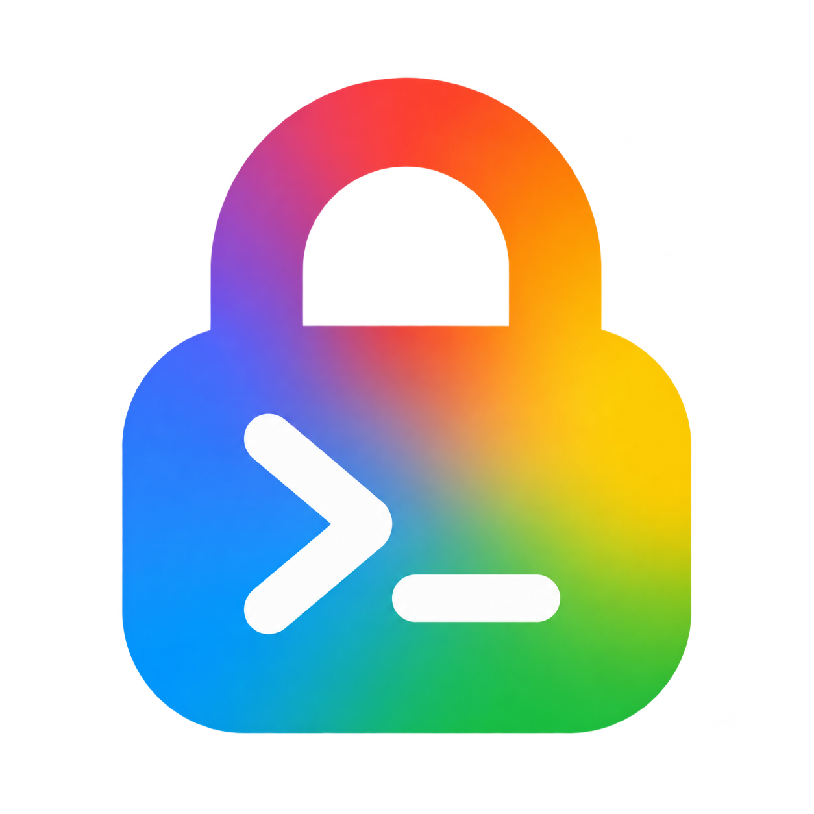

<p align="center">
  
</p>

<h1 align="center">Remote SSH Password Memory</h1>

<p align="center">
  <a href="https://marketplace.visualstudio.com/items?itemName=Devlin.remote-ssh-password-memory"></a>
  <a href="https://marketplace.visualstudio.com/items?itemName=Devlin.remote-ssh-password-memory"></a>
</p>

<p align="center">
  <a href="https://github.com/Gerard-Devlin/RemoteSSH-password/actions/workflows/ci.yml"></a>
  <a href="https://github.com/Gerard-Devlin/RemoteSSH-password/releases"></a>
  <a href="https://github.com/Gerard-Devlin/RemoteSSH-password/stargazers"></a>
  <a href="https://github.com/Gerard-Devlin/RemoteSSH-password/blob/main/LICENSE"></a>
</p>

<p align="center">Remember fixed SSH passwords in VS Code. Keep using Microsoft Remote-SSH.</p>

<p align="center">
  <a href="https://marketplace.visualstudio.com/items?itemName=Devlin.remote-ssh-password-memory">Install from Marketplace</a> ·
  <a href="#quick-start">Quick start</a> ·
  <a href="https://github.com/Gerard-Devlin/RemoteSSH-password/blob/main/docs/compatibility.md">Compatibility</a> ·
  <a href="https://github.com/Gerard-Devlin/RemoteSSH-password/blob/main/docs/troubleshooting.md">Troubleshooting</a> ·
  <a href="https://github.com/Gerard-Devlin/RemoteSSH-password/blob/main/CONTRIBUTING.md">Contributing</a> ·
  <a href="https://github.com/Gerard-Devlin/RemoteSSH-password/blob/main/docs/README.zh-CN.md">Simplified Chinese guide</a>
</p>

A Windows x64 and macOS companion extension for [Microsoft Remote-SSH](https://code.visualstudio.com/docs/remote/ssh). Enter a password in VS Code, choose whether to remember it, and reconnect without typing it again. OpenSSH still handles the connection, server identity checks, terminals, and forwarding.

> **Version 1.2.0.** Includes Windows x64 and separate macOS Apple Silicon / Intel packages. The minimum VS Code API is 1.73.0, and the extension is compiled against that API. Use the newest Microsoft Remote-SSH release compatible with your VS Code version. See the [compatibility requirements](https://github.com/Gerard-Devlin/RemoteSSH-password/blob/main/docs/compatibility.md) and [current test report](https://github.com/Gerard-Devlin/RemoteSSH-password/blob/main/docs/testing/2026-11-09.md) for validation coverage.

## Features

- **Ready after installation.** Password memory starts automatically in the local window. No Enable command or setup dialog is required.

- **Save after success.** A password is written to VS Code SecretStorage only after confirmed password authentication.
- **Remember or use once.** Each new password has an explicit persistence choice.
- **Match the actual destination.** Credentials use OpenSSH's effective host, port, and username, bound to a verified server fingerprint.
- **Recover from rejection.** A saved password is offered automatically at most once per connection. A rejected password prompts for a replacement.
- **Stay inside VS Code.** Native masked input, host-trust confirmation, credential management, and diagnostics. English and Simplified Chinese follow the display language.
- **Keep the Remote-SSH workflow.** SSH and adjacent SCP bridges support the connection and upload paths without modifying Microsoft's extension.
- **Restore settings.** Disabling, or a normal uninstall followed by a full restart, restores only values still installed by this extension.

## Quick start

### Requirements

- Windows **x64** or macOS **Apple Silicon / Intel**, using the local VS Code UI extension host.
- VS Code **1.73.0+** with the newest compatible Microsoft Remote-SSH release; the current integration was inspected at **0.128.0**.
- A listed, exact Windows OpenSSH build or macOS OpenSSH **9.0+** with `LogVerbose` support.
- A direct SSH connection using a fixed password. Jump hosts, OTP, and key-passphrase memory are outside this release's password-memory scope.

See [supported builds and fallback behavior](https://github.com/Gerard-Devlin/RemoteSSH-password/blob/main/docs/compatibility.md). The native bridges are unsigned local builds. This project is independent of Microsoft.

### Moving from the local-tools preview

Restore the old extension’s SSH settings, uninstall it, and reload VS Code before installing the Devlin package. Saved passwords do not automatically move between extension identities. Follow the [migration guide](https://github.com/Gerard-Devlin/RemoteSSH-password/blob/main/docs/marketplace.md#migrate-from-the-local-tools-preview).

If the old preview has already been removed and Enable reports its helper path as unsupported, version 0.1.8+ can recover that exact stale path during setup. Current releases recover that path automatically during local activation; old passwords are not transferred.

### Install and connect

1. Install [Remote SSH Password Memory](https://marketplace.visualstudio.com/items?itemName=Devlin.remote-ssh-password-memory) from the VS Code Marketplace. In the Extensions view, search for `Devlin.remote-ssh-password-memory` and check the publisher is **Devlin**.
2. Ensure Microsoft Remote-SSH is installed. Choose the package matching your local VS Code architecture: `win32-x64`, `darwin-arm64` (Apple Silicon), or `darwin-x64` (Intel). For manual installation, download `remote-ssh-password-memory-1.2.0-win32-x64.vsix` from [GitHub Releases](https://github.com/Gerard-Devlin/RemoteSSH-password/releases) and choose **Install from VSIX…**.
3. Password memory starts automatically in the local window. No setup command is needed.
4. Use **Remote-SSH: Connect to Host…** as usual. Verify any first-time server fingerprint before accepting it.
5. Enter the password in the masked VS Code input. Choose **Remember on This Device** or **Use Once**.
6. After successful authentication, use **Manage Saved Passwords** to inspect the destination and fingerprint. Passwords are never displayed.

Or install a locally built package from the repository root:

```powershell
code --install-extension ./artifacts/remote-ssh-password-memory-1.2.0-win32-x64.vsix
```

Password memory starts automatically after installation and local activation. If you explicitly turn it off, it stays off until you choose to enable it again. Marketplace installations receive extension updates through VS Code, subject to your automatic-update settings. Manual VSIX packages remain available from GitHub Releases. The extension collects no telemetry.

## Commands

Open the Command Palette with **Ctrl+Shift+P** (macOS: **Cmd+Shift+P**). Commands appear under **SSH Password Memory**, with localized titles when Simplified Chinese is selected.

| Command                          | Purpose                                                                            |
| -------------------------------- | ---------------------------------------------------------------------------------- |
| Enable                           | Resume password memory after turning it off.                                       |
| Manage Saved Passwords           | List saved destinations and fingerprints; select one to delete its saved password. |
| Delete Saved Password            | Remove a selected saved credential.                                                |
| Disable and Restore SSH Settings | Stop password memory and restore settings still owned by the extension.            |
| Show Diagnostics                 | Show platform, local SSH helper path, and service status without passwords.        |

Command IDs remain stable across languages; see the [contributor guide](https://github.com/Gerard-Devlin/RemoteSSH-password/blob/main/CONTRIBUTING.md).

## Language

The extension uses VS Code's [native localization](https://github.com/microsoft/vscode-l10n). English is the default; **Simplified Chinese (`zh-cn`)** is included. Use **Configure Display Language** and restart VS Code to switch. Command titles, input boxes, choices, confirmations, and diagnostics follow that language.

Authentication challenges and fingerprint values are kept verbatim. Standard server-trust requests use localized server, key-type, and fingerprint details; unrecognized requests retain the original OpenSSH text. There is no separate extension language setting. The main repository documentation is in English; a [Chinese quick-start guide](https://github.com/Gerard-Devlin/RemoteSSH-password/blob/main/docs/README.zh-CN.md) is available separately.

## Settings and removal

Enabling writes exactly two user settings:

| Setting                     | Value while enabled                                                                                                 |
| --------------------------- | ------------------------------------------------------------------------------------------------------------------- |
| `remote.SSH.path`           | A persistent `bridge-v2/<version-hash>/ssh.exe` (Windows) or `ssh` (macOS) path in this extension's global storage. |
| `remote.SSH.useLocalServer` | `true`                                                                                                              |

Original values are recorded in local state and a password-free `recovery.json`. Other settings and your SSH config remain intact.

Before uninstalling, forget credentials you want removed. A normal uninstall runs the registered `vscode:uninstall` recovery hook on the next full VS Code restart, restoring only unchanged extension-owned SSH settings while preserving JSONC comments and later user edits. Until that restart, the retained bridge keeps ordinary OpenSSH usable. Explicit **Disable and Restore SSH Settings** remains available for immediate restoration. Follow the [recovery instructions](https://github.com/Gerard-Devlin/RemoteSSH-password/blob/main/docs/troubleshooting.md#restore-remote-ssh-after-removal) if extension or global-storage files were manually deleted.

## Security and scope

Passwords use `ExtensionContext.secrets` rather than a custom password file. Managed authentication transports answers through memory and restricted local pipes or Unix sockets, not command-line arguments, environment variables, or temporary text files. Server fingerprint checks stay enabled; new or changed fingerprints are never silently trusted.

Direct SSH passwords and a verified, single interactive Password request can be remembered. The Remember choice is for a fixed server password. Verification codes, key passphrases, unrecognized requests, and additional interactive steps remain manual. This cannot protect secrets from malware already controlling your local account. Read the [security model](https://github.com/Gerard-Devlin/RemoteSSH-password/blob/main/SECURITY.md) for identity checks, local transport, memory limitations, and reporting guidance.

## Documentation

| Guide                                                                                                                | Contents                                                                |
| -------------------------------------------------------------------------------------------------------------------- | ----------------------------------------------------------------------- |
| [Compatibility](https://github.com/Gerard-Devlin/RemoteSSH-password/blob/main/docs/compatibility.md)                 | Exact supported build, unsupported modes, and fallback.                 |
| [Troubleshooting](https://github.com/Gerard-Devlin/RemoteSSH-password/blob/main/docs/troubleshooting.md)             | Diagnostics, password failures, disable/uninstall, and manual recovery. |
| [Architecture](https://github.com/Gerard-Devlin/RemoteSSH-password/blob/main/docs/architecture.md)                   | Extension, broker, SSH/SCP, and ASKPASS responsibilities.               |
| [Testing](https://github.com/Gerard-Devlin/RemoteSSH-password/blob/main/docs/testing.md)                             | Test layers, commands, and manual acceptance checklist.                 |
| [Latest local test report](https://github.com/Gerard-Devlin/RemoteSSH-password/blob/main/docs/testing/2026-11-09.md) | Reproducible evidence and remaining gaps.                               |
| [Contributing](https://github.com/Gerard-Devlin/RemoteSSH-password/blob/main/CONTRIBUTING.md)                        | Development, translations, repository layout, and release checklist.    |
| [UI text guide](https://github.com/Gerard-Devlin/RemoteSSH-password/blob/main/docs/ui-text.md)                       | Reviewed screens, shared terms, and localization conventions.           |
| [Changelog](https://github.com/Gerard-Devlin/RemoteSSH-password/blob/main/CHANGELOG.md)                              | Version history.                                                        |

## Development

Requires Windows x64 or macOS, Node.js 22+, npm, and Go 1.24+. macOS native builds use Xcode Command Line Tools and libproc for process identity. GCC is needed for Windows race detection.

```powershell
npm ci
npm run check
npm run package
npm run verify:package
# Build all three packages on macOS:
npm run package:all
```

The [contributor guide](https://github.com/Gerard-Devlin/RemoteSSH-password/blob/main/CONTRIBUTING.md) covers loopback integration tests, isolated VS Code testing, and packaging. Generated binaries, VSIX files, and local test profiles are excluded from source control. Source and issue links point to the GitHub repository. The extension is published under `Devlin`; the same verified platform packages are also attached to each GitHub Release. Follow the [upload and migration guide](https://github.com/Gerard-Devlin/RemoteSSH-password/blob/main/docs/marketplace.md) when moving from the old `local-tools` preview.

For later updates, run `npm run version:patch` and use the explicit distribution workflow described in the [release guide](https://github.com/Gerard-Devlin/RemoteSSH-password/blob/main/docs/marketplace.md#stable-releases). Automatic preview distribution is opt-in; merging a candidate to main does not consume its version.

## License

[MIT](https://github.com/Gerard-Devlin/RemoteSSH-password/blob/main/LICENSE). Native dependency licenses are listed in [THIRD-PARTY-NOTICES.txt](https://github.com/Gerard-Devlin/RemoteSSH-password/blob/main/THIRD-PARTY-NOTICES.txt).
